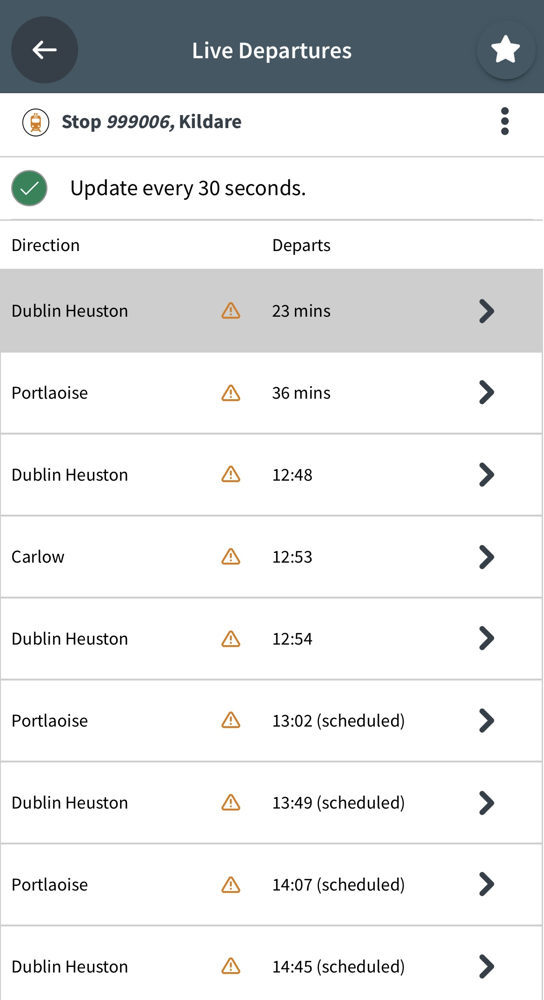
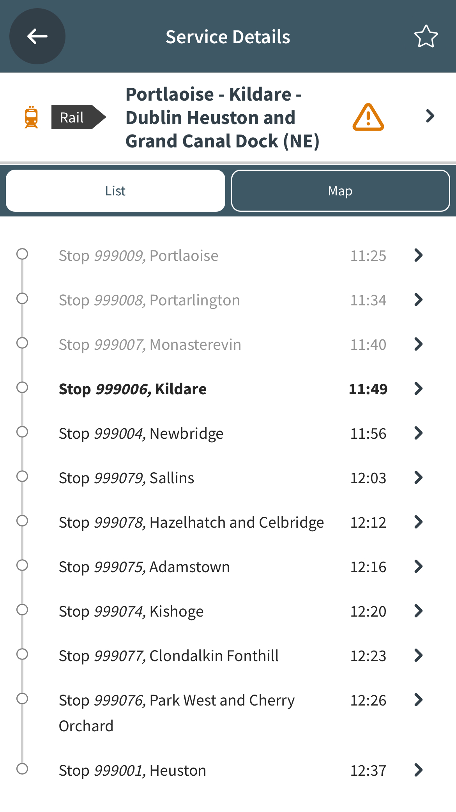

# DCP 2026 Assignment
Assignment for Data Centric Programming 2026

# Description
This project will analyse my daily commute from Kildare into Dublin Heuston. I will be comparing the actual arrival time of trains compared to their scheduled times, the origin of the train, the amount of stops before and after my destination and also the actual arrival time in comparison to the expected one. The hope of this assignment is that I will find / pinpoint the major cause of delays when it comes to train delays during my commute.


# CSV File
My CSV contains 13 attributes

| Column | Type of Data | Purpose |
|---|---|---|
| ID | Primary Key | The ID is simply here to act as a unique identifier, as I usually get similarly timed trains, this just acts as the primary key|
| Date | Date | Date will show what day the train was taken on, as previously mentioned I get similarly timed trains so this can be used to see which days of the week tend to be busiest |
| My_origin | Categorical | This displays the stop which I get on the train |
| Train_origin | Categorical | Where the train originated |
| My_destination | Categorical | The station where I plan to get off the train |
| Train_destination | Categorical | Where the train terminates |
| Due_time | Numerical / Time | The time when the train is scheduled to arrive at my_origin |
| Actual_due_time | Numerical / Time | The time when the train arrives at my_origin |
| Arrival_time | Numerical / Time | The time when the train is scheduled to reach my_destination |
| Actual_arrival_time | Numerical / Time | The when the train actually reachs my_destionation |
| Previous_stops | Numerical | The number before my_origin |
| Later_stops | Numerical | Number of stops between my_origin and my_destination |
| Comments | String | An additional column to account for anything that might delay the train significantly and potentially skew the results |

# Data Collection




I got my data primarily using the TFI Live app, this allowed me to track when trains were due in and when they were scheduled to arrive, then with me actually taking these trains I was able to verify its validity. I would also plan ahead on the Irish Journey Planner to find when the trains are meant to arrive

# Program Description

This program uses the data that was collected and stored in `dcp26.csv` to create a database and use SQL queries from `sqlite` to extract the information into a dataframe using `pandas`. Using this I can analyse the data and make charts with `matplotlib` to create visual aspects.

# Using the Program

## Prerequisites

To ensure the code works as intended you need to have python, pandas, matplotlib and sqlite installed on your devise, along with the CSV file `dcp26.csv`

## The Menu

Once you run the program you will be greeted by a menu, simply enter the number for the option you wish to pick

```Python
Welcome to Data Centric Programming Project!
What would you like to do?
    1. View Raw Data
    2. Look at Charts
    3. Quit
```

Both options 1 and 2 lead to further menus, simply follow the same procedure

# How it works

The program is entirely dependent on the functionality on SQLite and Pandas, in nearly every graph I calculate the train delay using time columns in my csv and it also works thanks to pandas

```Python
def delay_calc(scheduled, actual):
    scheduled = dt.strptime(scheduled, '%H:%M')
    actual = dt.strptime(actual, '%H:%M')
    
    delay = actual - scheduled
    return int(delay.total_seconds() / 60)
```

Then I use matplotlib to graph the plots, using ID as the x axis, then either delay or delay per stop on the y axis

```Python
plt.bar(ids, due_times_delay, color = colours)

    plt.xlabel("ID")
    plt.ylabel("Delay (Minutes)")
    plt.title("Train Pick Up Delay")
```

I also use a function to create a list of colours, the greener it is, the closer it is to being on time, then gets redder the more its delayed

# Findings
Looking at the graph, I found that there is actually a slight pattern in the delays, for most trains they lose about a minute behind schedule per stop, then theres occasional large spikes in the results, but its very rare to see two spikes close together. Suggesting that after a massive delay, you can expect your trains to run fairly on time for the following week or two.

## What I am most proud of in the assignment
I am most proud of how I managed to take something as ordinary as my daily commute and turn it into a project where I could collect, process and analyse real world data. I particularly enjoyed developing the different graphs and using colour coding to make patterns in the delays easier to identify. I'm also really proud of how I was about to keep my code efficient using functions where applicable

## What I learned
Throughout this assignment, I gained a much better understanding of how Python libraries such as Pandas, SQLite and Matplotlib can work together. I also improved my ability to write SQL queries, manipulate dataframes and visualise datasets.

## Reflection 
Overall, I really enjoyed this assignment as it allowed me to apply what I had learned in class to something relevant to my everyday life. There were a few challenges along the way, particularly when working with Matplotlib and organising the different graphs, but overcoming these helped me develop my programming skills. If I were to improve the project in the future, I would look at collecting a larger dataset over a longer period to make my findings more reliable and identify more definite trends.